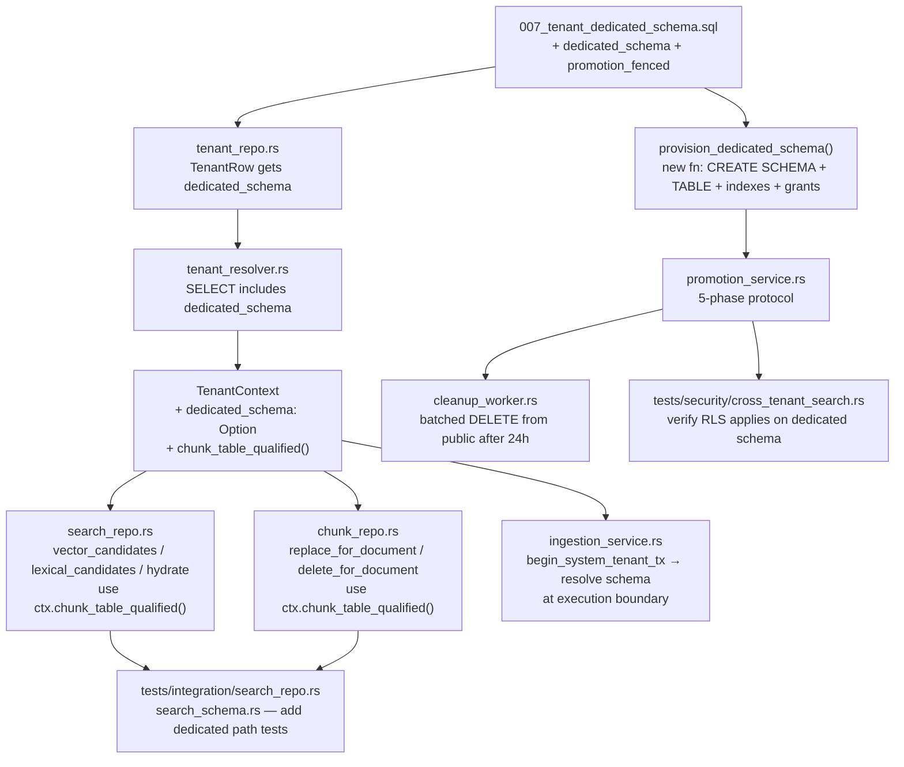
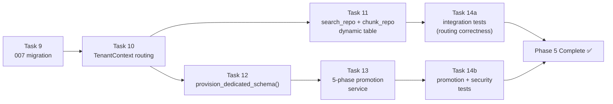

# Dedicated Schema Redesign — Gap Analysis & Implementation Plan
> **Phase 5 · Post-Task8 · Option B.1**  
> Status: Done through Task 8. Next: `007_tenant_dedicated_schema.sql` + routing layer.

---

## 1. Where We Stand (Current State)

### What's Built (Tasks 1–8 ✅)
| Layer | File | Current State |
|---|---|---|
| DB Schema | `006_search.sql` | Shared `public.document_chunks`, HNSW `m=16/ef=64`, GIN tsv |
| Chunk routing | `chunk_repo.rs` | Hard-coded `document_chunks` (no schema prefix) |
| Search routing | `search_repo.rs` | Hard-coded `document_chunks` + `documents` (no schema prefix) |
| Tenant context | `TenantContext` | Has `tenant_id`, `user_id`, `role` — **no** `dedicated_schema` field |
| Tenants table | `tenant_repo.rs` | Has `id, name, slug, plan, status` — **no** `dedicated_schema` / `promotion_fenced` columns |
| TX helpers | `common-database/lib.rs` | `begin_tenant_tx` / `begin_system_tenant_tx` locked to `search_path=public` ✅ |

### What the RFC Needs
1. `tenants` table: two new columns (`dedicated_schema TEXT`, `promotion_fenced BOOL`)
2. `TenantContext`: carry resolved schema so callers never re-query
3. `chunk_table_qualified()` on `TenantContext`: validated, injection-proof identifier
4. `search_repo.rs` + `chunk_repo.rs`: dynamic table name interpolation
5. Dedicated schema DDL provisioning runbook / Rust function
6. 5-phase promotion protocol (can be an async Rust service or SQL proc)
7. `ingestion_service.rs` + worker: resolve schema at execution boundary, not dispatch
8. Deferred async cleanup job for Phase 5 (batched deletes from `public`)
9. Integration + security tests for the new routing paths

---

## 2. The Core Design Tension: Where Does Schema Routing Live?

This is the most important architectural decision for the redesign. Three options:

### Option A — Resolve in `TenantContext` (Recommended ✅)
```
tenant_resolver → DB → TenantContext { tenant_id, user_id, role, dedicated_schema: Option<String> }
                                                                     ↓
                                                        ctx.chunk_table_qualified() → "&'static str"
```
**Pros:** Single lookup at middleware; every downstream caller is dumb and fast.  
**Cons:** `TenantContext` now needs a `String` field (tiny heap cost); resolver needs one extra column in its SELECT.

### Option B — Resolve per-call in repos
Each repo queries `tenants.dedicated_schema` itself.  
**Reject:** N+1 latency per search; couples repos to the `tenants` table.

### Option C — Resolve in `begin_tenant_tx` / `begin_system_tenant_tx`
Pass schema back as a second return value.  
**Reject:** Changes the signature of a crate used system-wide; breaks the ingestion worker contract.

> [!IMPORTANT]
> **Go with Option A.** `TenantContext::chunk_table_qualified()` is the correct seam.  
> `tenant_resolver.rs` already does the membership lookup; add one column to that query.

---

## 3. The SQL Injection Risk — Why This Matters

`search_repo.rs` today uses sqlx parameterized queries. With dynamic table names,  
you **cannot** bind a table name as a `$1` parameter — it must be interpolated into the query string.

The RFC specifies the validation regex: `^tenant_[a-z0-9_]{1,63}$`

```rust
// In TenantContext
pub fn chunk_table_qualified(&self) -> Cow<'static, str> {
    match &self.dedicated_schema {
        Some(schema) => {
            // Validated at build time; schema came from a DB column, never from user input.
            // Extra defense: assert the invariant at TenantContext construction.
            Cow::Owned(format!("{schema}.document_chunks"))
        }
        None => Cow::Borrowed("public.document_chunks"),
    }
}
```

> [!CAUTION]
> Never interpolate `dedicated_schema` from anywhere except a validated DB column.  
> The validator must run at `TenantContext` construction, not at query time, so that  
> a corrupted DB value cannot reach a live query string.

---

## 4. Impact Map — Every File That Changes



---

## 5. Task Breakdown (Phase 5 Continuation)

### Task 9 — Migration `007_tenant_dedicated_schema.sql`

```sql
-- Adds promotion state columns to tenants
ALTER TABLE tenants
    ADD COLUMN dedicated_schema text
        CHECK (dedicated_schema IS NULL OR dedicated_schema ~ '^tenant_[a-z0-9_]{1,63}$'),
    ADD COLUMN promotion_fenced boolean NOT NULL DEFAULT false;

-- Index: worker resolves schema by tenant_id frequently
CREATE INDEX tenants_dedicated_schema_idx
    ON tenants (id) WHERE dedicated_schema IS NOT NULL;
```

**Files:** `apps/tenant-saas/migrations/007_tenant_dedicated_schema.sql`

---

### Task 10 — `TenantContext` + `tenant_resolver.rs` + `tenant_repo.rs`

**`common-auth/src/context.rs`** — add field + accessor:
```rust
pub struct TenantContext {
    tenant_id: Uuid,
    user_id: Uuid,
    role: TenantRole,
    // None → public.document_chunks; Some → validated schema
    dedicated_schema: Option<ValidatedSchema>,
}

impl TenantContext {
    // Validated newtype — regex checked at construction
    pub fn chunk_table_qualified(&self) -> Cow<'static, str> { ... }
}
```

**`tenant_repo.rs`** — `TenantRow` picks up `dedicated_schema: Option<String>`.

**`tenant_resolver.rs`** — add `dedicated_schema` to the membership SELECT; pass it into `TenantContext::from_verified_membership`.

> [!NOTE]
> `from_verified_membership` signature changes — it's guarded by CI grep. Update the guard.

---

### Task 11 — Dynamic Table Routing in `search_repo.rs` and `chunk_repo.rs`

Both repos switch from hard-coded `document_chunks` to `ctx.chunk_table_qualified()`.

**Key detail — `hydrate()` joins `documents`:**
```sql
-- BEFORE (broken with dedicated schema: document_chunks is in tenant_X schema,
--         but documents is always in public)
FROM document_chunks c JOIN documents d ...

-- AFTER (always schema-qualify the join target)
FROM {chunk_table} c JOIN public.documents d ON d.tenant_id = c.tenant_id AND d.id = c.document_id
```

> [!WARNING]
> `documents` must always be qualified as `public.documents` even when chunks are in a dedicated schema.  
> The FK in the dedicated table already points to `public.documents` — the join must match.

For worker path (`begin_system_tenant_tx`), the ingestion service needs to query `tenants.dedicated_schema` at the start of the job execution transaction:
```rust
// ingestion_service.rs — at execution boundary, NOT at dispatch time
let schema = tenant_repo::get_dedicated_schema(&mut tx, tenant_id).await?;
// build a lightweight ChunkTarget enum: Shared | Dedicated(ValidatedSchema)
```

---

### Task 12 — `provision_dedicated_schema()` function

A `db_owner`-level Rust function (or SQL proc callable from migrations/runbook) that executes the full DDL from §2.5 of the RFC:

1. `CREATE SCHEMA IF NOT EXISTS tenant_<id>`
2. `REVOKE/GRANT` schema permissions
3. `CREATE TABLE` with all constraints + FK to `public.documents`
4. `ENABLE ROW LEVEL SECURITY` + three policies
5. `GRANT SELECT, INSERT, UPDATE, DELETE` to `app_runtime`
6. `CREATE INDEX ... GIN` (inside transaction)
7. `CREATE INDEX CONCURRENTLY ... HNSW m=24/ef=128` (outside transaction)
8. `UPDATE public.tenants SET dedicated_schema = ...`

> [!NOTE]
> Step 7 (`CREATE INDEX CONCURRENTLY`) cannot run inside a transaction block.  
> This means provisioning needs two phases: a transactional DDL step + a non-transactional index build.  
> The `promotion_fenced` flag stays `true` until step 7 completes.

---

### Task 13 — 5-Phase Promotion Protocol

A new `promotion_service.rs` (or CLI subcommand) implementing:

| Phase | Action | Key guard |
|---|---|---|
| 1 | Pre-copy bulk INSERT with `ON CONFLICT DO NOTHING` | Zero downtime |
| 2 | `pg_advisory_xact_lock` + set `promotion_fenced = true` | Drain in-flight jobs |
| 3 | Delta sync (`created_at >= pre_copy_start`) + atomic schema flip | `ON CONFLICT DO UPDATE` |
| 4 | Row count parity check; leave public rows intact | Rollback = NULL flip |
| 5 | Deferred batched DELETE (5k rows/tx, 24h later) | Prevents WAL explosion |

**Rollback path:**
```sql
UPDATE public.tenants SET dedicated_schema = NULL, promotion_fenced = false WHERE id = $1;
```
Instant, zero data loss — public rows are intact.

---

### Task 14 — Tests

| Test file | What to verify |
|---|---|
| `tests/integration/search_schema.rs` | Search on dedicated schema returns correct results; RLS blocks cross-tenant |
| `tests/integration/search_repo.rs` | `vector_candidates` / `lexical_candidates` route to correct table |
| `tests/security/cross_tenant_search.rs` | RLS on `tenant_X.document_chunks` prevents cross-tenant reads |
| `tests/integration/ingestion_pipeline.rs` | Ingestion worker writes to dedicated schema post-promotion |
| Unit test in `context.rs` | `chunk_table_qualified()` rejects invalid schema strings |

---

## 6. Open Design Decisions & Status

> [!NOTE]
> Questions 1–3 have been decided. Questions 4 & 5 remain under consideration.

1. **Who triggers promotion?**  
   * **DECISION: B) Operator CLI command.**  
   * Implementation: `cargo run --bin promote-tenant -- --tenant-id <uuid>`. Provides safe, human-supervised execution for Phase 5 / MVP.

2. **Where does `provision_dedicated_schema` run?**  
   * **DECISION: Rust async function called from the promotion CLI using a separate `DB_OWNER_URL` environment variable.**  
   * Rationale: Normal `app_runtime` has no DDL permissions (`CREATE SCHEMA`, `CREATE TABLE`). Provisioning runs with migration/owner privileges directly before Phase 1 copy.

3. **Does `dedicated_schema` belong in `common-auth`?**  
   * **DECISION: Option A — Keep `common-auth` pure; create domain-level routing in `apps/tenant-saas`.**  
   * Implementation: `common-auth` remains untouched and 100% focused on identity and RBAC. In `apps/tenant-saas`, define a domain type `ChunkTarget` (`Shared` vs `Dedicated(ValidatedSchema)`). HTTP requests pair `TenantContext` + `ChunkTarget` into a `RequestContext`, while background workers resolve `ChunkTarget` at the transaction execution boundary via `tenant_repo`.

4. **HNSW index on shared table: upgrade `m=16/ef=64` → `m=24/ef=128`?**  
   * **STATUS: Pending decision.**  
   * Context: Rebuilding the shared table index concurrently would improve recall for tenants in the 20k–50k transition zone still residing in `public.document_chunks`.

5. **Clock skew handling in delta sync (Phase 3)?**  
   * **STATUS: Pending decision.**  
   * Context: Evaluating watermark sequence/row ID vs `created_at` timestamp comparison.

---

## 7. Risk Register

| Risk | Severity | Mitigation |
|---|---|---|
| Delta sync misses rows with `created_at` clock skew | 🔴 High | Use `ON CONFLICT DO UPDATE` in Phase 3; verify with row count + spot check |
| `app_tenant_id()` not visible in `tenant_X` schema | 🟡 Medium | Function lives in `public`; `search_path` irrelevant since function name is called unqualified — test this in Task 14 |
| `sqlx` query macro (`query!`) rejects dynamic table | 🟡 Medium | Use `sqlx::query()` (non-macro) for all chunk-routed queries; they're already non-macro |
| Promotion fence deadlock (advisory lock timeout) | 🟡 Medium | Set `lock_timeout = '30s'` before acquiring advisory lock |
| Search regression during promotion window | 🟢 Low | Phase 2 fence pauses ingestion only; search continues on public until Phase 3 flip |
| Index build (HNSW CONCURRENTLY) OOM on 95k vectors | 🟢 Low | 95k × 1536 × 4 bytes ≈ 580 MB — fits in 16 GB RAM with `maintenance_work_mem = 2GB` |

---

## 8. Recommended Sequence



Tasks 9→10→11→14a can be done as a straight sequence (no promotion logic needed to test routing).  
Tasks 12→13→14b are the operational path and can run in parallel with 11.
