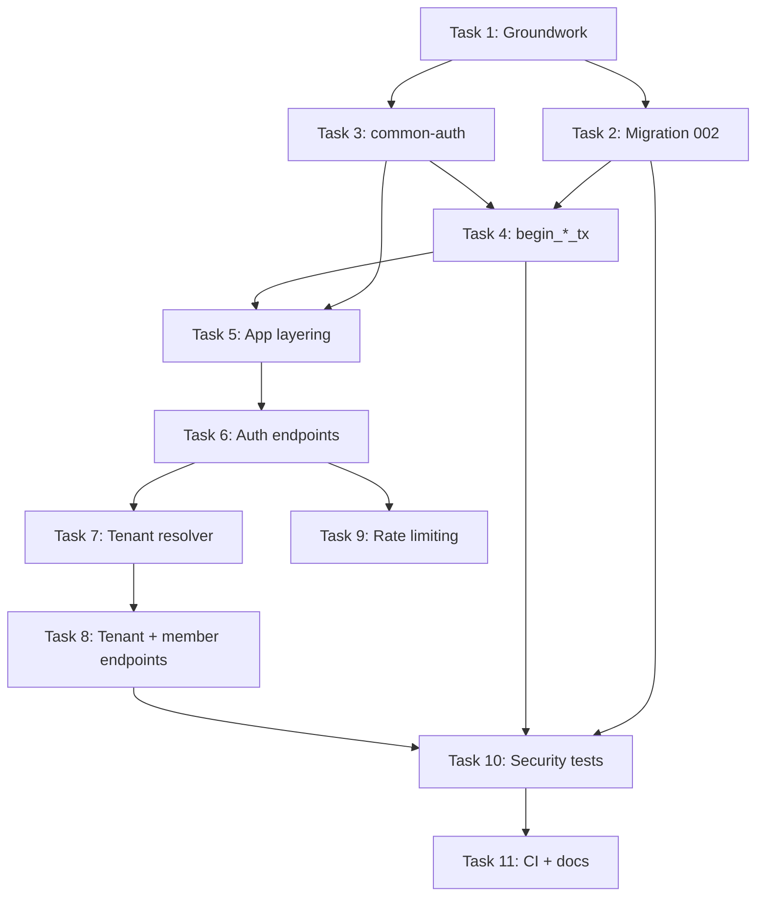

# Phase 2 — Identity and Tenancy Implementation Plan

> Source of truth: `multi_tenant_ai_saas_system_design.md` §3, §7, §8.2–8.4, §13.2–13.3, §14.1–14.2, §19.3, §23 (Phase 2).
> Builds on: `phase1_implementation_plan.md` (completed; see "Phase 1 baseline" below).
> Budget: Week 2, ~15–20 focused hours.

---

## 0. Goal and exit criteria

Deliver authenticated users, multi-tenant membership, role/permission checks, a **trusted `TenantContext`**, a **scoped transaction helper**, **RLS policies**, and **cross-tenant integration tests**.

Exit criteria (from the roadmap) and how this plan proves each one:

| Exit criterion | Proof |
|---|---|
| A user can join more than one tenant | `tests/integration/multi_tenant_membership.rs` — one user owns tenant A, is invited into tenant B, `GET /tenants` returns both with different roles |
| Role checks work | Permission matrix unit tests in `common-auth` + HTTP-level 403 tests per role per endpoint |
| Tenant A cannot read or modify Tenant B data | `tests/security/cross_tenant_*.rs` — SELECT / INSERT / UPDATE / DELETE through `app_runtime` with RLS (and through the HTTP API) |
| Pool reuse shows no tenant context leakage | `tests/security/pool_reuse.rs` — `max_connections=1`, commit/rollback/drop paths, plus 50-task mixed-tenant concurrency |

---

## 1. Phase 1 baseline (what already exists — do not redo)

Verified in the repo (`git log`: Tasks 1–8 done, Rust 1.99.1, sqlx 0.9, axum 0.8, tower-http 0.7):

| Area | State at start of Phase 2 | Phase 2 impact |
|---|---|---|
| Toolchain | `rust-toolchain.toml` pins **1.99.1**; CI uses `dtolnay/rust-toolchain@1.99.1` (must stay in sync); Dockerfile `ARG RUST_VERSION=1.99.1` | Any new dependency must compile on 1.99.1; do not bump the toolchain in Phase 2 |
| Workspace | `apps/tenant-saas` + 7 `common-*` crates; `common-auth` is a **stub** (empty `[dependencies]`) | Implement `common-auth`; extend `common-database` |
| DB roles | `db_owner` (migrations, `NOSUPERUSER`) and `app_runtime` (app role, `NOSUPERUSER`, `NOBYPASSRLS`) created during bootstrap in `infra/postgres/init/00_roles.sql` | Reuse. Grants + RLS added in `002_identity.sql` |
| Extensions | `uuid-ossp`, `citext` installed | `users.email` uses `CITEXT`; use `gen_random_uuid()` (built in, PG13+) for IDs |
| `common-database` | `create_pool` + `ping` only (deps: `common-config`, `common-errors`, `sqlx`; dev: `tokio`). `begin_tenant_tx` **deliberately absent** (Phase 1 Fix #3). One existing test (`create_pool_fails_gracefully_with_invalid_host`) must keep passing | Add `begin_user_tx` and `begin_tenant_tx`; add deps `common-auth`, `uuid` |
| `common-errors` | `AppError { NotFound, Unauthorized, Forbidden, Conflict(String), Validation(String), Database(sqlx::Error), ExternalService(String), Internal(String) }`. `code()` is a fixed `&'static str` **per variant** (so `Conflict` is always `"CONFLICT"`); `Validation` → **422**; no `request_id` in body; `From<sqlx::Error>` already maps `RowNotFound` → `NotFound`, everything else → `Database` | See Task 1 item 4 for the (small, breaking-only-inside-this-crate) changes |
| `common-config` | Hand-rolled `load_from_env_getter` (the workspace `config` crate is declared but **unused**). `AuthConfig { jwt_secret (≥32 chars), jwt_expiry_secs }` default **3600**; a unit test asserts `3600`; `.env.example` has `JWT_EXPIRY_SECS=3600` under `# AUTH (Phase 2)` | Add fields in the same style (`required`/`text`/`number` helpers); update the 3600 assertion and `.env.example` when moving to 900 |
| `common-telemetry` | `init_tracing(rust_log)` JSON logs, `try_init` (safe to call repeatedly) | Reuse; secret-leak test installs its own capturing subscriber |
| App | `main.rs` is **binary-only** (`mod app_state; mod handlers; mod routes;`). `AppState { db, config }` with `#[allow(dead_code)]` on `config` ("first read in Phase 2"). `routes.rs` already has `SetRequestId → Trace (span has `request_id`) → PropagateRequestId → Timeout(30s)` layers, a comment saying `/api/v1` routes arrive in Phase 2, and unit tests that **construct `AppState { db, config }` literally** via `connect_lazy` | Split into lib + bin; remove the `allow(dead_code)`; adding fields to `AppState` requires updating that test helper (introduce `AppState::new(...)`/test builder once, reuse everywhere) |
| Migrations | `001_foundation.sql` (extensions only). Embedded via `sqlx::migrate!("./migrations")`, run in-process only when `APP_ENV=development` using `DATABASE_MIGRATION_URL`; CI runs `sqlx migrate run` as `db_owner`. Both paths share `_sqlx_migrations` | **Never edit 001** (checksum would break existing dev DBs). `002_identity.sql` is purely additive and uses the same 3-digit naming |
| Env/dev flow | `.env` (git-ignored, copied from `.env.example`) loaded by `dotenvy` in `AppConfig::load()`; `README` Quick Start | Add new keys to `.env.example` **and** README so a fresh clone still works with no manual steps |
| Tests | `tests/{integration,performance,security}/` exist but are empty and not part of any Cargo package; no test touches a real DB yet (existing app tests use `connect_lazy` against a dead port) | Create a real test crate (see Task 1) |
| CI | Job env vars are named **`BOOTSTRAP_URL`** (superuser bootstrap), **`MIGRATION_URL`** (`db_owner`), and **`RUNTIME_URL`** (`app_runtime`); test step sets `DATABASE_URL=$RUNTIME_URL`; roles created from `infra/postgres/init/00_roles.sql`; Postgres image `pgvector/pgvector:0.8.0-pg16`; clippy runs `--workspace --all-targets --all-features -D warnings`; `sqlx-cli` installed **unpinned** (`--locked`); no `APP_ENV`, `JWT_SECRET`, or storage vars are set | Reuse those names; export `DATABASE_MIGRATION_URL` for the test step; tests must build config via an env getter (like `routes.rs` tests), not rely on a `.env` |
| Docker | `Dockerfile` uses cargo-chef and `COPY . .`; `.dockerignore` excludes `docs`, `infra`, `.github`, not `tests` | A new `tests` workspace member must have its `Cargo.toml` present (it will); no Dockerfile change needed |
| Compose | Postgres `pgvector/pgvector:0.8.0-pg16` with `00_roles.sql` init mounted; `POSTGRES_USER=postgres` (bootstrap only); `POSTGRES_HOST_PORT` override; MinIO is `pgsty/silo` | Unchanged. Tests honor the `DATABASE_URL` port from `.env` |
| ADRs | ADR-001 modular monolith, ADR-002 rust-axum-tokio, ADR-003 shared-postgres-schema exist in `docs/adr/` | Add ADR-004 (same naming style) |

**Phase 1 superuser caveat resolution:** In Phase 1, `POSTGRES_USER=postgres` was separated from `db_owner`. Both `db_owner` and `app_runtime` are explicitly provisioned as `NOSUPERUSER NOBYPASSRLS NOCREATEROLE` by `00_roles.sql`. Therefore:
- `db_owner` is a non-superuser table owner (subject to RLS on tables with `FORCE ROW LEVEL SECURITY`, but can read `users` without `FORCE` via definer functions).
- All isolation and security tests run through the `app_runtime` pool only.
- `db_owner` is used in tests only for fixture seeding/cleanup.
- A guard test asserts the runtime pool's role is `rolsuper = false AND rolbypassrls = false`.

---

**Phase 1 handoff table reconciliation** (`phase1_implementation_plan.md` §"Phase 1 → Phase 2 Handoff"):

| Handoff item | How this plan honors it |
|---|---|
| Add `users`, `tenants`, `memberships` with RLS | Migration `002_identity.sql` (the number reserved in Phase 1's schema schedule) |
| JWT + Argon2id, claims, `AuthenticatedPrincipal` | Task 3, 6 |
| `TenantContext` after membership verification | Task 3, 7 |
| `begin_tenant_tx` alongside RLS | Task 4 (shipped in the same phase as the policies, as Phase 1 Fix #3 required) |
| `common-auth` token verification, principal, permission structs | Task 3 |
| API routes `/auth/*`, `/tenants/*`, `/tenants/{id}/members/*` | Served under `/api/v1` per design §13 (Phase 1's handoff omitted the prefix; `routes.rs` already notes `/api/v1` arrives in Phase 2). `/health/*` stays unversioned |
| Cross-tenant tests (§19.3) | Task 10 |
| Phase 1 schema schedule: `003` documents, `004` ingestion, `005` search, `006` platform (`api_keys`, `usage_records`, `audit_logs`) | Untouched. `refresh_tokens` goes into `002` because it is identity data; `audit_logs` stays in `006` |

---

## 2. Key design decisions (resolve before coding)

These close gaps the design doc leaves open (§7.7 explicitly warns about global identity tables).

### D1 — Local auth, not OIDC
Argon2id passwords + signed JWT access tokens + opaque rotating refresh tokens. OIDC is out of scope. Email verification and password reset are **out of scope** (`email_verified_at` stays NULL; documented limitation).

### D2 — JWT carries identity only, never tenant
Access-token claims: `sub` (user id), `iss`, `aud`, `iat`, `nbf`, `exp`, `jti`, `typ="access"`. **No tenant or role claims**, so a revoked membership or role change takes effect on the next request (membership is read from the DB on every tenant-scoped request). This satisfies §3.3: a client-supplied `tenant_id` is only a hint.

### D3 — Two transaction-local GUCs
- `app.current_user_id` — set by `begin_user_tx`. Lets a user see **their own** memberships/tenants before a tenant is chosen.
- `app.current_tenant_id` — set by `begin_tenant_tx` (which also sets the user GUC).

Both are set with `set_config(name, value, true)` (transaction-local, §7.3). Policies use `NULLIF(current_setting(..., true), '')::uuid` so missing context **fails closed**.

### D4 — RLS design per table (the "global tables" problem)

| Table | RLS | Policy summary |
|---|---|---|
| `tenants` | ENABLE + FORCE | SELECT: `id = T` OR user has an *active* membership (`U`). INSERT: `id = T`. UPDATE: `id = T`. No DELETE grant. |
| `memberships` | ENABLE + FORCE | SELECT: `tenant_id = T` OR `user_id = U`. INSERT/UPDATE/DELETE: `tenant_id = T`. **No policy references `tenants`** (avoids policy recursion). |
| `users` | ENABLE (no FORCE) | SELECT/UPDATE: `id = U`. INSERT: allowed (registration, app generates the id and sets `U` to it so `RETURNING` passes). Cross-user lookups happen only through the narrow `SECURITY DEFINER` functions below. |
| `refresh_tokens` | none (not tenant data) | Looked up by SHA-256 of a 256-bit random secret; documented exception in ADR-004 |

`T` = `app.current_tenant_id`, `U` = `app.current_user_id`.

`users` is deliberately **not** `FORCE`d so that functions owned by `db_owner` can read it; `app_runtime` still cannot read other users' rows or `password_hash` directly.

### D5 — Narrow `SECURITY DEFINER` functions (owned by `db_owner`, `SET search_path = pg_catalog, public`, `REVOKE ... FROM PUBLIC`, `GRANT EXECUTE ... TO app_runtime`)

| Function | Purpose | Safety property |
|---|---|---|
| `auth_get_credentials(p_email citext)` | Login: returns `id, password_hash, status` | Only path to `password_hash` |
| `tenant_member_directory()` | Member list incl. email | Reads tenant from `app.current_tenant_id` — **takes no tenant parameter**, so it cannot be pointed at another tenant; returns empty if unset |
| `find_user_id_by_email(p_email citext)` | Invitations | Returns `uuid` only; raises if `app.current_tenant_id` is unset |

### D6 — Authorization split
- **Database** enforces the *tenant boundary* only (RLS).
- **Application** enforces *roles/permissions* (`Permission` checks in services). RLS policies do not encode roles, avoiding recursive policies on `memberships`. The "last active owner" invariant is enforced by a **DB trigger** (see Task 2) as defense in depth.

### D7 — Concealment policy (design §13.7)
- Not a member / unknown tenant / invalid tenant id → **404 `NOT_FOUND`** (identical body).
- Active member lacking permission → **403 `FORBIDDEN`**.
- Suspended membership or suspended tenant → **403 `FORBIDDEN`**.
- Unauthenticated / bad token → **401 `UNAUTHORIZED`**.

### D8 — Explicit role policy (design §3.2 asks for this to be explicit)

| Permission | Owner | Admin | Member | Viewer |
|---|---|---|---|---|
| `TenantUpdateSettings` (name) | ✔ | ✔ (name only) | – | – |
| `TenantManageCritical` (slug, plan, status) | ✔ | – | – | – |
| `MembersManage` | ✔ | ✔ (not Owners) | – | – |
| `DocumentsUpload` | ✔ | ✔ | ✔ | – |
| `DocumentsSearch` | ✔ | ✔ | ✔ | ✔ |
| `DocumentsDeleteAny` | ✔ | ✔ | – | – |
| `DocumentsDeleteOwn` | ✔ | ✔ | ✔ | – |
| `UsageViewAll` | ✔ | ✔ | – | – |
| `UsageViewOwn` (the "Limited" cell) | ✔ | ✔ | ✔ | – |

Chosen policy: **Members may delete their own uploads** (ownership check is enforced in Phase 3; the permission exists now and is tested at the matrix level).

Escalation rules (enforced in `MembershipService`, each with a test):
1. Only an Owner can grant or revoke the `owner` role or modify/remove an Owner.
2. An Admin can manage only `admin|member|viewer` members, and cannot promote anyone to `owner`.
3. Nobody can change their own role.
4. The last active Owner cannot be demoted, suspended, or removed (DB trigger + service pre-check).

### D9 — Scope cuts (explicit)
- Invitations create an `invited` membership for an **already-registered** user. `POST invitations` returns the same `202` for registered and unregistered emails (no enumeration); email delivery and token-link invitations are future work.
- Audit logging in Phase 2 = structured `tracing` events with `target="audit"` (no secrets/PII beyond ids). The `audit_logs` table stays in migration `006` (Phase 7).
- Access tokens cannot be revoked before expiry (≤15 min). Disabled users are rejected on the next request because the tenant resolver and `/auth/me` check `users.status`.
- JWT key rotation (`kid`) is deferred to Phase 7; algorithm is pinned to HS256.

---

## 3. Priority tiers

| Tier | Meaning |
|---|---|
| **P0** | Required for exit criteria |
| **P1** | Required by design doc security rules; do unless blocked |
| **P2** | Nice to have if time remains |

---

## 4. Tasks

Suggested order and time: Task 1 (2h) → 2 (3h) → 3 (2h) → 4 (1.5h) → 5 (2h) → 6 (4h) → 7 (3h) → 8 (3h) → 9 (1h). Tests are written alongside each task, not at the end.

### Task 1 — Carry-over groundwork *(P0, ~2h)*

1. **Lib + bin split** for `apps/tenant-saas`: add `src/lib.rs` exporting `pub mod {app_state, routes, handlers, ...}`; `main.rs` becomes a thin wrapper. This lets tests call `build_router(state)` and drive it with `tower::ServiceExt::oneshot`.
2. **Versioned routing**: keep `/health/*` at root; nest the new API under `/api/v1`.
3. **`request_id` in error bodies** (§13.1): `AppError::into_response` stays free of request state (as its Phase 1 doc comment says: "`request_id` is injected by the response layer"). Add a `middleware::from_fn` placed **inside** the existing `SetRequestIdLayer` that reads the `x-request-id` request header and, for responses carrying an `AppError` marker extension, rewrites the JSON body to add `error.request_id`. Note: the Phase 1 `TimeoutLayer` returns a bare `408` without the envelope; either accept that and document it, or wrap it with the same middleware.
4. **`AppError` changes (in `common-errors`, keeping existing tests green)**:
   - Add `TooManyRequests { retry_after_secs: u64 }` → 429, code `RATE_LIMITED`, `Retry-After` header.
   - Add `InvalidCredentials` → 401, code `INVALID_CREDENTIALS`.
   - `Conflict(String)` currently always emits code `CONFLICT`. Change it to `Conflict { code: &'static str, message: String }` (grep shows no `Conflict(` users outside the crate, so the blast radius is `common-errors` only) to support `EMAIL_ALREADY_REGISTERED`, `SLUG_TAKEN`, `ALREADY_MEMBER`, `LAST_OWNER`.
   - Keep `Validation` → 422 (matches design §13.7); malformed JSON/path ids that axum rejects stay 400/422 as axum emits them, but wrap axum's `JsonRejection` so they also use the envelope.
   - Constraint-name → code mapping is **domain knowledge** and lives in the app's `repositories` layer (`map_db_error`), not in `common-errors` or `common-database`; `From<sqlx::Error>` stays generic.
5. **Workspace deps** (`Cargo.toml` `[workspace.dependencies]`, then referenced with `{ workspace = true }` like Phase 1): `argon2`, `jsonwebtoken`, `rand`, `sha2`, `base64`, `redis` (Task 9; use the `tokio-comp` feature); dev: `http-body-util`. Phase 1 already pinned `uuid` (v4 + serde), `chrono`, `serde*`, `tracing*`, `thiserror 2`, `anyhow`. Add each with `cargo add --package <crate>`/manual edit and confirm `cargo check --workspace` on **1.99.1** before writing code against it (Phase 1 history shows version drift bit us: the sqlx-cli/rustc mismatch). Hand-roll validation (small value objects) instead of adding `validator`.
6. **Config additions** (`common-config`, `.env.example`, README, unit tests). Follow the existing pattern: new fields on `AuthConfig`/new structs, parsed with the existing `required`/`text`/`number` closures, validated in `validate()`; update `mock_env()` tests and the assertion `jwt_expiry_secs == 3600`:

   | Key | Default | Notes |
   |---|---|---|
   | `JWT_ISSUER` | `tenant-saas` | validated on every token |
   | `JWT_AUDIENCE` | `tenant-saas-api` | validated |
   | `JWT_EXPIRY_SECS` | **900** (was 3600) | short-lived per §14.2 |
   | `REFRESH_TOKEN_TTL_SECS` | 1209600 (14d) | |
   | `ARGON2_MEMORY_KIB` / `ARGON2_ITERATIONS` / `ARGON2_PARALLELISM` | 19456 / 2 / 1 | OWASP minimum; tune per host |
   | `AUTH_MAX_CONCURRENT_HASHES` | 4 | semaphore size |
   | `AUTH_RATE_LIMIT_*` | see Task 9 | |

7. **Test crate**: add `tests/Cargo.toml` (package `integration-tests`, add `"tests"` to workspace `members`, `autotests = false`) with explicit `[[test]]` targets: `integration` → `path = "integration/main.rs"`, `security` → `path = "security/main.rs"` (each `main.rs` declares `mod` per file; `performance/` stays empty until Phase 7). It depends on `tenant-saas` (the new lib), `common-*`, `sqlx`, `tokio`, `tower` (`util`), `http-body-util`. Shared `tests/common/mod.rs` containing:
   - `TestApp::spawn()` — calls `dotenvy::dotenv()` (local `.env`) then builds `AppConfig` through `load_from_env_getter` with fallbacks for the vars CI doesn't set (`OBJECT_STORAGE_*`, `JWT_SECRET`), mirroring `routes.rs`'s `state_without_database`; builds `AppState` with an **`app_runtime`** pool (`DATABASE_URL`), plus an `owner_pool` from `DATABASE_MIGRATION_URL` for seeding only. Tests **fail loudly** (not skip) when `DATABASE_URL` is unset in CI; locally they print a skip notice only if `SKIP_DB_TESTS=1`.
   - Factories: `create_user(email)`, `create_tenant_with_owner(...)`, `add_member(tenant, user, role)` (via owner pool) and `login(user) -> tokens` (via API).
   - Unique emails/slugs per test (`uuid`-suffixed) — tests share one DB and run in parallel, which is a stronger isolation check than DB-per-test.
   - `test_support_notes` table created idempotently via the owner pool with the **same policy template** documents will use in Phase 3 (see Task 10); this validates the template early without adding a throwaway table to production migrations.
8. Update the CI `test` job (see Task 11 for exact edits): keep `DATABASE_URL: ${{ env.RUNTIME_URL }}` and **add** `DATABASE_MIGRATION_URL: ${{ env.MIGRATION_URL }}` for the owner pool. `sqlx-cli` is currently unpinned in CI; it only runs migrations, and the app embeds its own, so no change is required — but if CLI/crate checksum behavior ever diverges, pin both together.
9. **Query style decision**: use runtime-checked `sqlx::query_as::<_, T>` in Phase 2 (no `query!` macros) so `SQLX_OFFLINE` caches are not required yet; DB-backed tests are the safety net. Revisit in Phase 7.

10. **Update the Phase 1 test helper** in `routes.rs` (`state_without_database`) to use the new `AppState` constructor so the existing `liveness_is_ok_without_database` / `readiness_is_503_without_database` tests keep passing without a DB. Redis in `AppState` must be lazily connected so those tests still need no Redis either.
11. **Do not touch** `001_foundation.sql`, `infra/postgres/init/00_roles.sql`, `docker-compose.yml`, or the Dockerfile in this phase.

**Done when:** `cargo fmt --all --check`, `cargo clippy --workspace --all-targets --all-features -- -D warnings`, and `cargo test --workspace` (the exact Phase 1 CI commands) are still green, `GET /health/live` and `/health/ready` behave exactly as before, error bodies include `request_id`.

---

### Task 2 — Migration `002_identity.sql` *(P0, ~3h)*

File: `apps/tenant-saas/migrations/002_identity.sql` (run as `db_owner`).

```sql
-- ===== users (global identity) =====
CREATE TABLE users (
    id                uuid        PRIMARY KEY DEFAULT gen_random_uuid(),
    email             citext      NOT NULL UNIQUE,
    password_hash     text,                      -- NULL for external-only identity
    email_verified_at timestamptz,
    status            text        NOT NULL DEFAULT 'active'
                      CHECK (status IN ('active','disabled','pending')),
    created_at        timestamptz NOT NULL DEFAULT now(),
    updated_at        timestamptz NOT NULL DEFAULT now(),
    CONSTRAINT users_email_len CHECK (char_length(email) BETWEEN 3 AND 254)
);

-- ===== tenants =====
CREATE TABLE tenants (
    id         uuid        PRIMARY KEY DEFAULT gen_random_uuid(),
    name       text        NOT NULL CHECK (char_length(name) BETWEEN 1 AND 100),
    slug       text        NOT NULL UNIQUE
               CHECK (slug ~ '^[a-z0-9](?:[a-z0-9-]{1,48}[a-z0-9])$'),
    plan       text        NOT NULL DEFAULT 'free',
    status     text        NOT NULL DEFAULT 'active'
               CHECK (status IN ('active','suspended','deleted')),
    created_at timestamptz NOT NULL DEFAULT now(),
    updated_at timestamptz NOT NULL DEFAULT now()
);

-- ===== memberships =====
CREATE TABLE memberships (
    id         uuid        PRIMARY KEY DEFAULT gen_random_uuid(),
    tenant_id  uuid        NOT NULL REFERENCES tenants(id) ON DELETE CASCADE,
    user_id    uuid        NOT NULL REFERENCES users(id)   ON DELETE CASCADE,
    role       text        NOT NULL CHECK (role   IN ('owner','admin','member','viewer')),
    status     text        NOT NULL CHECK (status IN ('invited','active','suspended')),
    invited_by uuid        REFERENCES users(id) ON DELETE SET NULL,
    created_at timestamptz NOT NULL DEFAULT now(),
    updated_at timestamptz NOT NULL DEFAULT now(),
    CONSTRAINT memberships_tenant_user_unique UNIQUE (tenant_id, user_id),
    -- composite-FK target for tenant-owned children (design §7.6)
    CONSTRAINT memberships_tenant_id_id_unique UNIQUE (tenant_id, id)
);
CREATE INDEX memberships_user_idx ON memberships (user_id, status);

-- ===== refresh_tokens (not tenant data) =====
CREATE TABLE refresh_tokens (
    id         uuid        PRIMARY KEY DEFAULT gen_random_uuid(),
    user_id    uuid        NOT NULL REFERENCES users(id) ON DELETE CASCADE,
    family_id  uuid        NOT NULL,
    token_hash bytea       NOT NULL UNIQUE,      -- SHA-256 of the opaque token
    expires_at timestamptz NOT NULL,
    rotated_at timestamptz,
    revoked_at timestamptz,
    created_at timestamptz NOT NULL DEFAULT now()
);
CREATE INDEX refresh_tokens_family_idx ON refresh_tokens (family_id);
CREATE INDEX refresh_tokens_user_idx   ON refresh_tokens (user_id);
```

**`updated_at`**: one shared `set_updated_at()` trigger function applied to `users`, `tenants`, `memberships`.

**Last-owner trigger** (BEFORE UPDATE OR DELETE on `memberships`):
```sql
CREATE FUNCTION memberships_protect_last_owner() RETURNS trigger AS $$
DECLARE remaining int;
BEGIN
  IF OLD.role = 'owner' AND OLD.status = 'active'
     AND (TG_OP = 'DELETE' OR NEW.role <> 'owner' OR NEW.status <> 'active') THEN
    -- lock all active owner rows so concurrent demotions serialize
    PERFORM 1 FROM memberships
      WHERE tenant_id = OLD.tenant_id AND role = 'owner' AND status = 'active'
      FOR UPDATE;
    SELECT count(*) INTO remaining FROM memberships
      WHERE tenant_id = OLD.tenant_id AND role = 'owner'
        AND status = 'active' AND id <> OLD.id;
    IF remaining = 0 THEN
      RAISE EXCEPTION 'last active owner' USING ERRCODE = 'P0001', HINT = 'LAST_OWNER';
    END IF;
  END IF;
  RETURN CASE WHEN TG_OP = 'DELETE' THEN OLD ELSE NEW END;
END $$ LANGUAGE plpgsql;
```
Map `P0001` + `LAST_OWNER` hint → `AppError::Conflict` with code `LAST_OWNER`. The trigger is invoker-security; it runs inside the tenant transaction so RLS and the tenant GUC still apply.

**Grants** (all against `app_runtime`; also `REVOKE ALL ON ... FROM PUBLIC`):
```sql
GRANT SELECT, INSERT, UPDATE (status, updated_at) ON users TO app_runtime;  -- see note
GRANT SELECT, INSERT, UPDATE ON tenants, memberships TO app_runtime;
GRANT DELETE ON memberships TO app_runtime;                 -- no DELETE on tenants/users
GRANT SELECT, INSERT, UPDATE ON refresh_tokens TO app_runtime;
```
Note on `users`: revoke whole-table SELECT and grant **column-level** `SELECT (id, email, status, email_verified_at, created_at, updated_at)` so `password_hash` is unreadable except via `auth_get_credentials`. Grant `INSERT (id, email, password_hash, status)`.

**RLS** (templates follow design §7.4, one policy per command, all `TO app_runtime`):
```sql
-- shared helpers (STABLE, invoker, pinned search_path)
CREATE FUNCTION app_tenant_id() RETURNS uuid LANGUAGE sql STABLE AS
  $$ SELECT NULLIF(current_setting('app.current_tenant_id', true), '')::uuid $$;
CREATE FUNCTION app_user_id()   RETURNS uuid LANGUAGE sql STABLE AS
  $$ SELECT NULLIF(current_setting('app.current_user_id',   true), '')::uuid $$;
GRANT EXECUTE ON FUNCTION app_tenant_id(), app_user_id() TO app_runtime;
```
Use these helpers in every policy so Phase 3+ tables reuse the identical expression (and `(SELECT app_tenant_id())` form lets the planner cache it as an InitPlan).

Policies as in decision D4: `tenants`/`memberships` → ENABLE + FORCE; `users` → ENABLE only.

**Definer functions** (D5) with `REVOKE EXECUTE ... FROM PUBLIC; GRANT EXECUTE ... TO app_runtime`.

**Verification queries** (added to CI "RLS sanity" step and to the test crate):
- `SELECT rolsuper, rolbypassrls, rolcreaterole FROM pg_roles WHERE rolname='app_runtime'` → all `false`.
- `SELECT relname, relrowsecurity, relforcerowsecurity FROM pg_class WHERE relname IN ('tenants','memberships','users')` → expected flags.
- As `app_runtime`: `SELECT password_hash FROM users` → `permission denied`.

**Done when:** `sqlx migrate run` applies cleanly on a fresh DB and on top of `001`; down-migration is *not* provided (forward-only; document in ADR-004).

---

### Task 3 — `common-auth` crate *(P0, ~2h)*

Pure types and verification logic. **No DB access** (§6.2).

```text
crates/common-auth/src/
  lib.rs
  role.rs          // TenantRole { Owner, Admin, Member, Viewer } + FromStr/Display, rank()
  permission.rs    // Permission enum, Permissions(bitset), role_permissions(role)
  password.rs      // PasswordHasher (Argon2id), verify with dummy-hash timing equalization
  token.rs         // AccessClaims, TokenService::{issue_access, verify_access}
  refresh.rs       // generate_refresh_token() -> (plain, sha256_hash)
  principal.rs     // AuthenticatedPrincipal { user_id, token_id }
  context.rs       // TenantContext (immutable)
```

Requirements:
- `TenantRole`/`Permission` serialize as lowercase strings matching the DB check constraint; round-trip tests for every variant.
- `role_permissions(role)` is a single exhaustive `match` implementing the D8 matrix; a table-driven test asserts the **entire** matrix (4 roles × 9 permissions) so any accidental change fails loudly.
- `TenantRole::can_manage(target: TenantRole)` encodes escalation rule 1–2; tested exhaustively (16 combinations).
- **Passwords**: Argon2id with config params; PHC-string output; min 12 / max 128 chars (max bounds hashing cost); hashing/verifying run via `tokio::task::spawn_blocking` guarded by a `Semaphore` (`AUTH_MAX_CONCURRENT_HASHES`) so login floods can't starve the Tokio runtime. A precomputed `DUMMY_HASH` is verified when the email is unknown so unknown/known-email responses have similar latency.
- **JWT**: `jsonwebtoken` with `Validation::new(Algorithm::HS256)` (algorithm pinned — never read from the header); set `iss`, `aud`, `validate_exp`, `validate_nbf`, `leeway ≤ 30s`, `required_spec_claims = {exp, iss, aud, sub}`, and reject `typ != "access"`. Tests: expired, wrong issuer, wrong audience, wrong secret, `alg=none`, tampered payload, `typ=refresh`.
- **Refresh tokens**: 32 random bytes (OS CSPRNG), base64url; only `SHA-256` stored. Never logged — implement `Debug` manually (redacted) on any struct holding secrets.
- `TenantContext { tenant_id, user_id, role, permissions }`: private fields + getters (immutable). Rust cannot restrict construction across crates, so expose exactly one constructor `TenantContext::from_verified_membership(...)`, call it from **one** app module (`auth::tenant_resolver`), and add a CI grep guard (Task 10) that fails if the constructor appears anywhere else.
- `TenantContext::require(Permission) -> Result<(), AppError>` returns `Forbidden`.

---

### Task 4 — `common-database`: scoped transaction helpers *(P0, ~1.5h)*

`common-database` depends on `common-auth` for `TenantContext` (types only; no cycle).

```rust
/// Identity-scoped tx: sets app.current_user_id. Used for login follow-ups,
/// listing the caller's tenants/invitations, and membership resolution.
pub async fn begin_user_tx(pool: &PgPool, user_id: Uuid)
    -> Result<Transaction<'static, Postgres>, AppError>;

/// Tenant-scoped tx. Requires a verified TenantContext (cannot be called with a raw Uuid
/// from a request). Sets BOTH app.current_tenant_id and app.current_user_id.
pub async fn begin_tenant_tx(pool: &PgPool, ctx: &TenantContext)
    -> Result<Transaction<'static, Postgres>, AppError>;
```

Implementation notes:
- One round trip: `SELECT set_config('app.current_tenant_id',$1,true), set_config('app.current_user_id',$2,true)`.
- Execute on `&mut *tx` (verify against pinned sqlx 0.9 executor syntax; keep the helper centralized).
- Signature takes `&TenantContext`, not `Uuid`, so call sites cannot bypass membership verification by accident. Tests that need a forged/invalid context issue their own `set_config` SQL on a raw pool transaction — no `test-support` feature (CI clippy runs `--all-features`, so such a feature would silently ship unchecked code in lint builds).
- Keep Phase 1's `create_pool`/`ping` untouched and add the new helpers beside them; `Cargo.toml` gains `common-auth` and `uuid` (workspace). `common-auth` depends on `common-errors` only, so there is no cycle (`common-errors` ← `common-auth` ← `common-database`).
- DB error → `AppError` mapping (`map_db_error`) lives in the **app's** `repositories` layer, not here (see Task 1 item 4): unique violations (`23505`) by constraint name (`users_email_key` → `EMAIL_ALREADY_REGISTERED`, `tenants_slug_key` → `SLUG_TAKEN`, `memberships_tenant_user_unique` → `ALREADY_MEMBER`); `P0001` with hint `LAST_OWNER` → `LAST_OWNER`; check/FK violations → `Validation`; everything else → existing `AppError::Database` (no SQL leaked, already guaranteed by Phase 1).
- Document the micro-scoped rule (§7.3.1) in rustdoc: **no network I/O while a tx is open**; transactions are returned to the pool before calling Redis, hashing, or (later) S3/LLM.

Unit/DB tests (in this crate, `#[ignore]`-free but skipped when `DATABASE_URL` is unset):
- GUC visible inside tx, empty after commit and after rollback.
- Dropping an uncommitted tx rolls back and clears the GUC.

---

### Task 5 — Application layering for identity *(P0, ~2h, scaffolding)*

Follow §6.3/§6.4: routes → services → repositories; domain has no Axum/SQLx types.

```text
apps/tenant-saas/src/
  lib.rs, main.rs, app_state.rs, routes.rs
  middleware/
    request_id.rs     (existing logic extracted)
    rate_limit.rs     (Task 9)
  auth/
    extractors.rs     // AuthenticatedPrincipal (Bearer), TenantCtx (Path tenant_id + principal)
    tenant_resolver.rs// ONLY place that builds TenantContext
  domain/
    user.rs tenant.rs membership.rs   // entities, value objects (Email, Slug), validation
  services/
    auth_service.rs tenant_service.rs membership_service.rs
  repositories/
    user_repo.rs tenant_repo.rs membership_repo.rs refresh_token_repo.rs
  handlers/
    health.rs auth.rs tenants.rs members.rs invitations.rs
```

Value objects with validation (unit-tested): `Email` (trim, lowercase, RFC-lite check, ≤254), `Slug` (matches DB regex), `TenantName` (1–100, trimmed, no control chars), `Password` (length bounds; never `Debug`-prints).

`AppState` additions: `token_service: Arc<TokenService>`, `password_hasher: Arc<PasswordHasher>`, `redis` (Task 9).

---

### Task 6 — Auth endpoints *(P0, ~4h)*

All under `/api/v1/auth`. JSON bodies, explicit body-size limit (e.g. 16 KiB via `DefaultBodyLimit`).

| Endpoint | Behavior |
|---|---|
| `POST /auth/register` | Validate email/password. Generate `user_id` in the app. `begin_user_tx(user_id)` → insert user (hash computed **before** opening the tx). `201 { id, email, created_at }`. Duplicate email → `409 EMAIL_ALREADY_REGISTERED`. No tokens issued (client logs in). |
| `POST /auth/login` | Rate-limited. `auth_get_credentials(email)`; always run an Argon2 verify (dummy hash if unknown). Same `401 INVALID_CREDENTIALS` body for unknown email, wrong password, or `status != 'active'`. On success: issue access JWT + refresh token (new `family_id`). `200 { access_token, token_type:"Bearer", expires_in, refresh_token }`. |
| `POST /auth/refresh` | Atomic rotation in one tx: `UPDATE refresh_tokens SET rotated_at=now() WHERE token_hash=$1 AND rotated_at IS NULL AND revoked_at IS NULL AND expires_at>now() RETURNING user_id, family_id`. If no row but the hash exists with `rotated_at` set → **reuse detected**: revoke whole family, `401`. On success insert the next token in the same family and verify `users.status='active'`. |
| `POST /auth/logout` | Auth required. Body `{refresh_token}`; revokes its family. Idempotent `204`. |
| `GET /auth/me` | Auth required. Returns user + the caller's active memberships `[{tenant_id, slug, name, role}]` via `begin_user_tx`. Rejects disabled users. |

Authentication extractor behavior: missing/malformed `Authorization`, bad signature, expiry, wrong `iss`/`aud`/`typ` → `401 UNAUTHORIZED` with a single generic message (never the jsonwebtoken error text).

Logging rules (§14.4): never log passwords, tokens, hashes; log `user_id`, `request_id`, outcome only. Add a test that runs a login/register under a captured `tracing` subscriber and asserts none of the secret strings appear.

---

### Task 7 — Tenant context resolution and extractor *(P0, ~3h)*

`auth::tenant_resolver::resolve(state, principal, tenant_id) -> Result<TenantContext, AppError>`:

1. `begin_user_tx(pool, principal.user_id)`.
2. One query (policies make this safe):
   ```sql
   SELECT m.role, m.status AS membership_status, t.status AS tenant_status, u.status AS user_status
   FROM memberships m
   JOIN tenants t ON t.id = m.tenant_id
   JOIN users   u ON u.id = m.user_id
   WHERE m.tenant_id = $1 AND m.user_id = $2
   ```
3. **Commit/drop the tx immediately** (micro-scoped rule), then decide:
   - no row → `NotFound` (D7 concealment);
   - `user_status != active` → `Unauthorized`;
   - membership `invited`/`suspended` or tenant not `active` → `Forbidden`;
   - else build `TenantContext::from_verified_membership(...)`.

The axum extractor `TenantCtx` reads `tenant_id` from the path via `RawPathParams` (invalid UUID → same `NOT_FOUND`), requires `AuthenticatedPrincipal`, and calls `resolve`. Handlers then do `ctx.require(Permission::X)?` and `begin_tenant_tx(&state.db, &ctx)`.

Never accept `tenant_id` from a body/header/query for authorization.

Optional (P2): cache the resolved membership in Redis for ≤5s. **Not recommended in Phase 2** — it weakens the "revoked membership takes effect immediately" test; revisit only if profiling demands it.

---

### Task 8 — Tenant and membership endpoints *(P0, ~3h)*

All under `/api/v1`, all require authentication.

| Endpoint | Context | Permission | Behavior |
|---|---|---|---|
| `POST /tenants` | user | any authenticated | Validate name/slug. Generate `tenant_id`. In **one tx** with GUCs `U` and `T=tenant_id`: insert tenant, insert membership `(owner, active)`. `201`. Duplicate slug → `409 SLUG_TAKEN`. (Per-user cap on owned tenants, e.g. 10 → `422`, to limit abuse.) |
| `GET /tenants` | user | – | The caller's **active** tenants with their role (RLS `U`-branch). Cursor/limit params (default 50, max 100). |
| `GET /tenants/{tenant_id}` | tenant | any active member | Tenant details + caller's role. |
| `PATCH /tenants/{tenant_id}` | tenant | `TenantUpdateSettings`; slug/plan/status require `TenantManageCritical` | Partial update; Admin sending `slug`/`plan`/`status` → `403`. |
| `POST /tenants/{tenant_id}/invitations` | tenant | `MembersManage` | `{email, role}`. Role check via `can_manage`. Lookup `find_user_id_by_email`; if found and not already a member, insert `invited` membership. **Always `202`** (no enumeration). Already-active member → still `202`, no change. |
| `GET /tenants/{tenant_id}/members` | tenant | `MembersManage` (Owner/Admin) *— or any member if you prefer a roster; pick one and test it* | Via `tenant_member_directory()`; paginated. |
| `PATCH /tenants/{tenant_id}/members/{user_id}` | tenant | `MembersManage` + escalation rules | Change `role` and/or `status`. Self role-change → `403`. Last owner → `409 LAST_OWNER`. |
| `DELETE /tenants/{tenant_id}/members/{user_id}` | tenant | `MembersManage` (or self-leave) | `204`. Escalation rules apply; last owner → `409`. |
| `GET /invitations` *(additive)* | user | – | Caller's pending invitations (`invited` memberships). |
| `POST /invitations/{tenant_id}/accept` *(additive)* | user → tenant | invitee only | Reads the caller's own `invited` membership via the `U` branch, then updates it to `active` in a tenant tx (T = that tenant). Only transition `invited → active` is allowed; role is unchanged. |

Status codes follow §13.7. Every mutating service method re-checks permissions server-side; none rely on the UI.

Audit events (`target="audit"`): `tenant.created`, `member.invited`, `member.role_changed`, `member.removed`, `invitation.accepted`, `auth.login_failed`, `auth.refresh_reuse_detected` — fields: `request_id`, `actor_user_id`, `tenant_id`, `target_user_id`, no secrets.

---

### Task 9 — Auth abuse controls *(P1, ~1h)*

Design §14.1/§15 require rate-limited login. Phase 1 already provides Redis in Compose.
- Token-bucket rate limiter backed by Redis with atomic Lua replenishment for `/auth/login`, `/auth/register`, `/auth/refresh`.
- Keys: per client IP, and per `sha256(email)` (never raw email in keys/logs). Defaults: 10 login attempts/min/IP, 5/min/email; configurable via `AUTH_RATE_LIMIT_*`.
- **Fail open with circuit breaker** when Redis is unavailable: auth endpoints allow requests with a WARN log (`auth.rate_limit_skipped`) and trip the circuit breaker open after consecutive failures to protect latency and maintain user availability.
- Exceeded → `429 RATE_LIMITED` with `Retry-After`.
- Tests: N+1th attempt returns 429; limit is shared across two simulated API replicas (same Redis); Redis down → fails open, logs warning, and trips circuit breaker.

If time is short, ship Task 9 as the last item; everything else is independent of it.

---

### Task 10 — Test suite *(P0 core, written alongside tasks)*

Layout:
```text
tests/
  Cargo.toml
  common/mod.rs
  integration/
    auth_flow.rs               register → login → me → refresh → logout
    multi_tenant_membership.rs one user, two tenants, different roles
    invitations.rs             invite → accept; no-enumeration behavior
    role_matrix_http.rs        every role × every endpoint → expected 200/403/404
  security/
    rls_policies.rs            raw-SQL SELECT/INSERT/UPDATE/DELETE as app_runtime
    cross_tenant_api.rs        User B calls A's endpoints with valid tokens
    pool_reuse.rs              context leakage tests
    token_attacks.rs           expired, alg=none, wrong aud/iss, tampered, refresh-as-access
    escalation.rs              role-escalation attempts, last-owner races
    secret_leakage.rs          logs contain no passwords/tokens
    sqli_payloads.rs           payloads in email, name, slug, role, path ids
    rls_guard.rs               app_runtime flags; forbidden constructor usage grep
```

Specific cases (maps to design §19.3):

**RLS (raw SQL through `app_runtime` pool)**
1. No GUC set → `SELECT` from `tenants`/`memberships`/`test_support_notes` returns 0 rows; `INSERT` fails with RLS violation (fail closed).
2. GUC = tenant A → sees only A rows; cannot `INSERT` a row with `tenant_id = B` (WITH CHECK violation); `UPDATE ... SET tenant_id = B` fails; `UPDATE`/`DELETE` of B's row affects 0 rows.
3. GUC = random/invalid string (`'not-a-uuid'`) → query errors safely (cast failure), never returns data.
4. Policy template parity: the `test_support_notes` table uses the exact policy template Phase 3 will copy.
5. `app_runtime` cannot `SELECT password_hash`, cannot `DELETE` from `tenants`/`users`, cannot `ALTER`/`CREATE`.

**Pool reuse (§19.3)**
- Pool `max_connections=1`: tx for tenant A → commit → plain `SELECT current_setting('app.current_tenant_id', true)` on the same physical connection returns NULL/empty. Repeat for rollback and for a dropped (never-committed) tx, and for a tx that errors mid-way.
- Interleave A, B, A on one connection; assert each sees only its own rows.
- Concurrency: 50 tokio tasks across 2 tenants on a pool of 5, each loops 20 times writing and reading its own marker rows; assert zero foreign rows ever observed and row counts match.

**API-level cross-tenant**
- User B (valid token) → `GET/PATCH /tenants/{A}`, `GET /tenants/{A}/members`, `PATCH/DELETE /tenants/{A}/members/{x}`, `POST invitations` → all `404`, response body byte-identical to a nonexistent tenant (no existence oracle).
- Revoked membership: remove/suspend B → next request with the **same still-valid token** returns `404`/`403` immediately.
- Disabled user: valid token → `401` on next request.

**Roles & escalation**
- Full role × endpoint matrix (Owner/Admin/Member/Viewer).
- Admin cannot promote to owner, cannot modify/remove an Owner, cannot change `slug/plan/status`; Member cannot invite; nobody changes own role.
- Last-owner: demote/remove/suspend sole owner → `409 LAST_OWNER`. **Race:** two owners demote each other concurrently → exactly one succeeds, tenant always retains ≥1 active owner.

**Tokens**
- Missing header, malformed bearer, expired, `nbf` in future, wrong `iss`, wrong `aud`, wrong secret, `alg=none`, tampered claims, refresh token used as access token → all `401`.
- Refresh rotation: reuse of a rotated token → `401` and the whole family is revoked (the newest token also stops working). Logout invalidates the refresh token.

**Misc**
- SQL-injection payloads in text fields stay inert (parameterized queries) and invalid slugs/roles → `422`.
- Login timing sanity (non-flaky): unknown vs known email both execute exactly one hash verify (assert via a counter in a test-instrumented hasher rather than wall-clock).
- Duplicate registration race: 20 concurrent registrations of the same email → exactly one `201`, rest `409`.

**Guards**
- CI grep step: `TenantContext::from_verified_membership` only appears in `auth/tenant_resolver.rs`, `common-auth`, and tests.
- CI grep step: no `set_config('app.current_tenant_id'` outside `common-database`.

---

### Task 11 — CI, docs, ADR *(P0/P1, ~1h)*

- **CI** (`.github/workflows/ci.yml`), minimal edits to the Phase 1 workflow — keep job names, the `1.99.1` toolchain refs, `MIGRATION_URL`/`RUNTIME_URL` env names, and the existing "Create app_runtime role", "Run migrations", and "Verify app_runtime cannot perform DDL" steps:
  1. After "Run migrations", add step **"RLS sanity"** (psql as `$MIGRATION_URL` for catalog checks, as `$RUNTIME_URL` for the `password_hash` denial) using the Task 2 verification queries; same `grep -q` assertion style as the DDL check.
  2. In the existing "Run tests" step, keep `DATABASE_URL: ${{ env.RUNTIME_URL }}` and add `DATABASE_MIGRATION_URL: ${{ env.MIGRATION_URL }}` and `REDIS_URL: redis://localhost:6379` (the Redis service already exists; defaults in config also point there).
  3. Add the two grep guards as a step in the `check` job.
  4. Leave the clippy line as is; the new code must pass `--all-targets --all-features -D warnings`, including the new `tests` crate.
- **ADR-004** `docs/adr/ADR-004-identity-and-rls-for-global-tables.md`: D1–D8 rationale, the `users` non-FORCE decision, definer-function whitelist, refresh-token table exception, forward-only migrations, known limitations (no email verification; access-token revocation latency).
- **README** (Phase 1 README is the template; keep its structure): add an "Auth quick-start" section after "Verify" with `curl` for register → login → create tenant → invite → accept; update the Workspace Layout comment for `common-auth` (no longer "Phase 2 stub") and mention the new `tests/` crate; extend the `Checks` section only if commands change (they should not). Add all new env vars to `.env.example` (replace the `# AUTH (Phase 2)` block; `JWT_EXPIRY_SECS=900`).
- **Dev DB note**: `APP_ENV=development` runs the embedded migrations on startup, so existing dev databases pick up `002` automatically; `infra/postgres/init/00_roles.sql` only runs on a fresh volume and needs no change. Document `docker compose ... down -v` for a clean slate (already in README).
- **Runbook note**: how to disable a user (`UPDATE users SET status='disabled'` as `db_owner`) and revoke refresh families.

---

## 5. Dependency graph



Parallelizable: Task 2 (SQL) and Task 3 (pure Rust) after Task 1; RLS raw-SQL tests can start as soon as Tasks 2 and 4 exist, before any HTTP handler.

---

## 6. Risks and mitigations

| Risk | Mitigation |
|---|---|
| Superuser bypass of RLS policies | Resolved in Phase 1: `POSTGRES_USER=postgres`; `db_owner` and `app_runtime` are both `NOSUPERUSER NOBYPASSRLS`. Isolation tests run via `app_runtime` pool; `rls_guard.rs` asserts `rolsuper=false, rolbypassrls=false` |
| Policy recursion (`memberships` ↔ `tenants`) | Only `tenants` policies reference `memberships`; `memberships` policies reference GUCs only |
| `INSERT ... RETURNING` fails RLS on `users` | App generates ids and sets `U` before insert |
| Definer functions become a data-exfiltration path | Fixed `search_path`, no tenant parameter, `REVOKE FROM PUBLIC`, tests that call them with no/foreign GUC |
| Argon2 starves the async runtime / DoS via long passwords | `spawn_blocking` + semaphore, 128-char cap, rate limiting |
| `TenantContext` forged elsewhere in the code | Single constructor, private fields, CI grep guard, `begin_tenant_tx` takes `&TenantContext` |
| Connection held during hashing or Redis calls | Hash/rate-limit **before** opening a tx (§7.3.1); review checklist item |
| Flaky timing tests | Count hasher invocations instead of measuring wall-clock |
| sqlx 0.9 / CLI version drift (Phase 1 history) | Embedded migrations in the app; pin CLI separately; avoid `query!` macros in Phase 2 |
| Pool exhaustion from tests (`max_connections=1` deadlocks) | Tests that need it use dedicated small pools; never nest two acquires in one task |

---

## 7. Phase 2 deliverable checklist

### Must complete (P0)
- [x] `apps/tenant-saas` split into lib + bin; `/api/v1` nesting; health routes unchanged
- [x] Error envelope includes `request_id`; `RATE_LIMITED`, `LAST_OWNER`, `SLUG_TAKEN`, `EMAIL_ALREADY_REGISTERED` codes
- [x] Config: issuer/audience/refresh TTL/Argon2 params; access TTL default 900; unit tests updated
- [x] `002_identity.sql`: `users`, `tenants`, `memberships`, `refresh_tokens`, triggers, grants, RLS, definer functions
- [x] `app_runtime` cannot read `password_hash`, cannot delete tenants/users, still has no DDL
- [x] `common-auth`: roles, permissions (full matrix tested), Argon2id, JWT (pinned HS256), refresh tokens, `TenantContext`
- [x] `common-database`: `begin_user_tx`, `begin_tenant_tx(&TenantContext)`, DB error mapping
- [x] Endpoints: register, login, refresh, logout, me
- [x] Endpoints: create/list/get/patch tenant; invite; list/patch/delete members; list/accept invitations
- [x] Tenant resolver: 404 concealment, 403 for insufficient role/suspended, immediate effect of revoked membership
- [x] Last-owner invariant (trigger + service) including race test
- [x] RLS tests for SELECT/INSERT/UPDATE/DELETE, missing context, invalid context
- [x] Pool-reuse tests (commit, rollback, drop, error, interleaved, 50-task concurrency)
- [x] Role × endpoint matrix and escalation tests
- [x] Token attack tests and refresh rotation/reuse detection
- [x] CI green: fmt, clippy `-D warnings`, migrations, RLS sanity, tests, grep guards

### Phase 1 regression guards (P0)
- [x] `001_foundation.sql`, `00_roles.sql`, `docker-compose.yml`, `Dockerfile` unmodified (`git diff` clean for those paths)
- [x] Existing Phase 1 unit tests still pass unchanged in intent: `common-config` (with the 900 default updated), `common-errors`, `common-database::create_pool_fails_gracefully...`, `routes.rs` health tests (no DB, no Redis needed)
- [x] `GET /health/live` and `/health/ready` still served at the root, unauthenticated, outside `/api/v1`
- [x] Release build and Docker build still succeed with the new `tests` workspace member
- [x] CI toolchain refs (`@1.99.1`) still match `rust-toolchain.toml`

### Should complete (P1)
- [x] Redis rate limiting on auth endpoints, fail-open with circuit breaker, 429 + `Retry-After`
- [x] Secret-leakage log test
- [x] ADR-004 and README auth quick-start

### Nice to have (P2)
- [ ] OpenAPI generation for the auth/tenant contract (design §13.1)
- [ ] Cursor pagination helper shared with Phase 3 document listing
- [ ] Per-user owned-tenant cap configurable

---

## 8. Phase 2 → Phase 3 handoff

| Concern | Phase 2 end state | Phase 3 uses it by |
|---|---|---|
| Tenant boundary | RLS template (`app_tenant_id()` helper, 4 explicit policies, ENABLE + FORCE) proven on `tenants`, `memberships`, and `test_support_notes` | Copy the template verbatim for `documents` in `003_documents.sql` |
| Composite FK pattern | `memberships (tenant_id, id)` unique target exists | `documents.uploaded_by` can reference `memberships` or `users`; add `UNIQUE (tenant_id, id)` on `documents` for later children |
| Tenant context | `TenantCtx` extractor + `begin_tenant_tx(&ctx)` | Upload handler: stream to storage **first**, then `begin_tenant_tx` for the metadata insert (§7.3.1) |
| Permissions | `DocumentsUpload`, `DocumentsDeleteAny`, `DocumentsDeleteOwn`, `DocumentsSearch` already defined and matrix-tested | Handlers call `ctx.require(...)`; Phase 3 adds the ownership check for `DeleteOwn` |
| Concealment | Cross-tenant → 404 with identical body | Document/status endpoints reuse the same behavior |
| Test harness | `TestApp`, factories, `test_support_notes` | Replace the probe table usage with `documents`; keep pool-reuse and concurrency tests running against it |
| Rate limiting | Redis limiter middleware | Add per-tenant upload limits (§15) |
| Audit | `target="audit"` tracing events | Persist to `audit_logs` in Phase 7 |

---

## 9. Definition of done for Phase 2

1. Fresh clone → `cp .env.example .env`, `docker compose -f infra/docker-compose.yml up -d --wait`, `cargo run --bin tenant-saas-api` (applies `001` + `002`), then register two users, create two tenants, and observe isolation using only README commands.
2. The exact Phase 1 CI commands — `cargo fmt --all --check`, `cargo clippy --workspace --all-targets --all-features -- -D warnings`, `cargo test --workspace` — pass locally and in CI, and the Phase 1 acceptance behavior is unchanged: `/health/live` 200 with PostgreSQL stopped, `/health/ready` 503, `app_runtime` still cannot run DDL.
3. Every exit criterion in §0 has a named, passing test.
4. No endpoint derives authorization from a client-supplied tenant id without a DB membership check.
5. ADR-004 merged; `phase2` checklist above fully ticked for P0 and P1.
